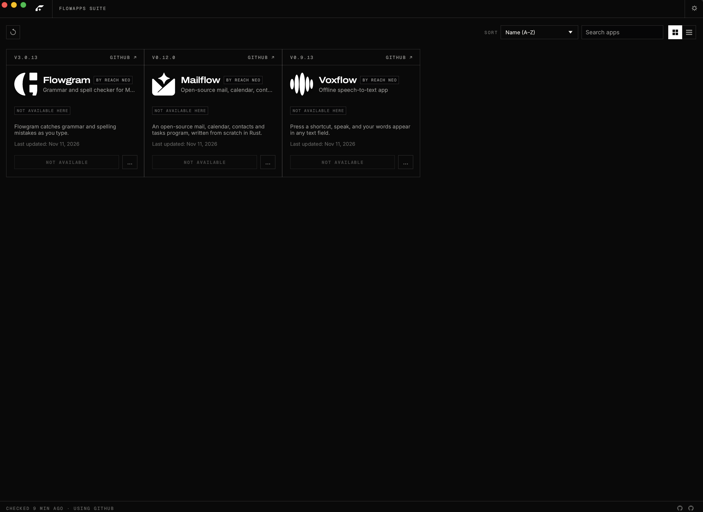

<p align="center">
  <a href="https://github.com/reachneoagent-commits">
    <picture>
      <source media="(prefers-color-scheme: dark)" srcset="docs/brand/flowapps-logo-white.svg">
      
    </picture>
  </a>
</p>

<p align="center">
  
</p>

<h1 align="center">FlowApps</h1>

<p align="center">
  <b>One place to install, update and open every app in the FlowApps suite, rebuilt in pure Rust.</b><br>
  Flowgram, Voxflow and Mailflow: the right build for your computer, kept up to date.
</p>

<p align="center">
  
  
  
  
</p>

<p align="center">
  <a href="https://github.com/reachneoagent-commits/Flow-launcher/releases/latest"><b>Download FlowApps</b></a> ·
  <a href="https://github.com/reachneoagent-commits">FlowApps on GitHub</a>
</p>

<p align="center">
  <a href="#what-it-does">What it does</a> ·
  <a href="#features">Features</a> ·
  <a href="#downloads">Downloads</a> ·
  <a href="#build-from-source">Build from source</a> ·
  <a href="#flowapps-suite">FlowApps Suite</a>
</p>

<p align="center">
  
</p>

## What it does

The FlowApps apps each ship their own builds for every platform. FlowApps saves you from
hunting through release pages: it lists every app in the suite, shows which ones you have
and which version, installs the right build for your operating system and processor, and tells
you when an update is out. It is a small native app that can sit in your menu bar or system tray.

## Features

<table>
  <tr>
    <td width="33%" valign="top">
      <h3>📦 Install in one click</h3>
      Picks the right download for your OS and CPU (DMG, MSI, AppImage, .deb, .rpm and more), checks it against the release's SHA-256 checksums and installs it.
    </td>
    <td width="33%" valign="top">
      <h3>🔄 Stay up to date</h3>
      Checks each app's GitHub releases and updates the ones you have. A notification tells you when there's something new.
    </td>
    <td width="33%" valign="top">
      <h3>🧭 Always at hand</h3>
      Opens any FlowApps app from one window, or from the tray and menu-bar icon. Native egui, no Electron, no web view.
    </td>
  </tr>
</table>

The web version shows the same catalog in the browser, with the latest download for each app.

## Interface languages

The interface is in English, Brazilian Portuguese (Português (Brasil)), Czech (Čeština), French
(Français), Georgian (ქართული), German (Deutsch), Hungarian (Magyar), Japanese (日本語), Polish
(Polski), Russian (Русский), Simplified Chinese (简体中文), Traditional Chinese (繁體中文) or Spanish
(Español). **Auto**, the default, follows the system or browser language; **Settings → Language**
picks one and switches at once, and the choice is kept between runs.

## Where apps are installed

FlowApps installs each app where your system normally keeps applications, using the
app's official release package, so an app installed by the launcher is the same as one you
installed by hand (and the launcher finds apps you installed yourself):

| System | Where | How |
|---|---|---|
| macOS | `/Applications/<App>.app` | Copied from the signed release DMG |
| Windows | `C:\Program Files\FlowApps\<App>` | The release MSI, through Windows Installer, for everyone on the computer |
| Linux | `/usr/bin`, `/usr/share/applications` | The release `.deb` (apt) or `.rpm` (dnf, zypper) |

FlowApps keeps itself current too: when a new version is out, **Update and restart**
downloads it, verifies it, puts it where this copy is installed and reopens it.

Updates use the same format an app was installed with. Every download is checked against the
release's published SHA-256 before it is installed, and a running app is never replaced.

The launcher writes its log to `logs/flowapps-launcher.log` in its data folder
(`~/.local/share/flowapps-launcher` on Linux, `~/Library/Application Support/FlowApps`
on macOS, `%LOCALAPPDATA%\FlowApps` on Windows).

## Downloads

Download the build for your computer from the [latest release](https://github.com/reachneoagent-commits/Flow-launcher/releases/latest), or browse [all releases](https://github.com/reachneoagent-commits/Flow-launcher/releases). Every release has a `SHA256SUMS.txt` to check the files against. `<ver>` is the version number, for example `0.1.0`.

**Windows** (10 and 11)

| File | What it is |
|---|---|
| `flowapps-launcher-<ver>-windows-x64.msi` | Installer for most PCs (Intel and AMD, 64-bit) |
| `flowapps-launcher-<ver>-windows-arm64.msi` | Installer for Windows on Arm |
| `flowapps-launcher-<ver>-windows-x86.msi` | Installer for 32-bit Windows |
| `flowapps-launcher-<ver>-windows-{x64,arm64,x86}-portable.zip` | No install: unzip and run `flowapps-launcher.exe` |

**macOS** (11 Big Sur or later)

| File | What it is |
|---|---|
| `flowapps-launcher-<ver>-macos-universal.dmg` | Universal app for Apple silicon and Intel Macs. Drag FlowApps to Applications |

**Linux** (x86_64 and aarch64; glibc 2.35 or newer)

| File | What it is |
|---|---|
| `flowapps-launcher-<ver>-linux-{x86_64,aarch64}.AppImage` | Runs on almost any distro without installing |
| `flowapps-launcher-<ver>-linux-{x86_64,aarch64}.deb` | Debian, Ubuntu, Mint, Pop!_OS: `sudo apt install ./flowapps-launcher-…deb` |
| `flowapps-launcher-<ver>-linux-{x86_64,aarch64}.rpm` | Fedora, openSUSE, RHEL: `sudo dnf install ./flowapps-launcher-…rpm` |
| `flowapps-launcher-<ver>-linux-{x86_64,aarch64}.flatpak` | Flatpak bundle |
| `flowapps-launcher-<ver>-linux-{x86_64,aarch64}.tar.gz` | Plain tree (`bin/`, `share/`) |

The tray icon uses the StatusNotifierItem standard: KDE, Xfce, Cinnamon and most other desktops show it; on GNOME install the AppIndicator extension.

## Build from source

You need a recent stable Rust (1.90 or newer). On Linux, install the windowing headers first
(Debian/Ubuntu: `sudo apt install libxkbcommon-dev libwayland-dev libx11-dev libxrandr-dev libxi-dev libgl1-mesa-dev`).

```sh
git clone https://github.com/reachneoagent-commits/Flow-launcher
cd Flow-launcher
cargo run --release -p flowapps-launcher   # the desktop app
cargo xtask ci                             # fmt, clippy, tests and the wasm check
```

## FlowApps Suite

FlowApps installs the **FlowApps Suite**: free, open-source apps from the FlowApps team,
each written from scratch in Rust and each able to stand on its own.

| App | What it's for | GitHub |
|---|---|---|
| **Flowgram** | Grammar and spell checker for Mac and Windows | [GitHub](https://github.com/reachneoagent-commits/flowgram) |
| **Voxflow** | Offline speech-to-text app | [GitHub](https://github.com/reachneoagent-commits/voxflow) |
| **Mailflow** | Mail, calendar, contacts and tasks app | [GitHub](https://github.com/UCS-Care-Group/mailcraft) |

## License and credits

FlowApps is forked from [ArtCraft Launcher](https://github.com/storytold/craft-launcher) by the ArtCraft team.
The install/update/uninstall engine, catalog format and UI patterns are adapted from ArtCraft Launcher,
which is dual-licensed under MIT or Apache-2.0. FlowApps is itself dual-licensed under
[MIT](LICENSE-MIT) or [Apache-2.0](LICENSE-APACHE), at your option.

**Copyright (c) 2026 Reach Neo.** Required notices are in [NOTICE](NOTICE).

Bundled fonts, icons, images and other assets keep their own open licenses; each one is listed
with its author, source and license in [ATTRIBUTION.md](ATTRIBUTION.md).

The app icons of the FlowApps apps (`assets/app-icons/`) are each app's own icon, copied from its
repository and licensed like that app (MIT OR Apache-2.0).

**The FlowApps name, logo and symbol are trademarks of Reach Neo.** They may not be used without
permission. The ArtCraft name, logo and "A" mark remain trademarks of the ArtCraft Team and are
not used in FlowApps.
